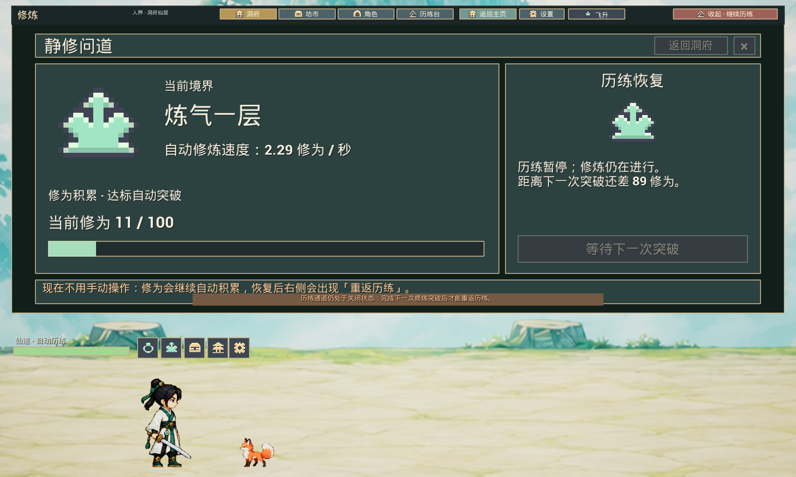
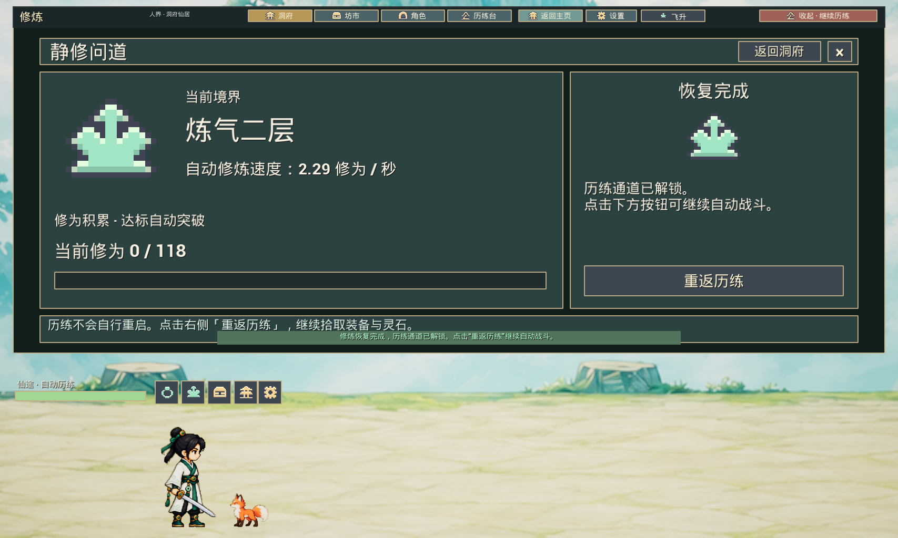

# 仙途 · Immortal Path

《仙途》是一款在桌面底部运行的单人修仙挂机游戏。角色会自动迎战妖兽，拾取装备、灵石和材料，并换上更强的装备。你可以独立修炼、炼丹、炼器、培养灵宠，逐步解锁历练区域、挑战首领。

## 下载试玩

[Windows x64 试玩版](https://github.com/Feign00/ImmortalPath-Playtest/releases/tag/v0.1.0-preview.1) · 下载 Windows ZIP，解压整个压缩包，再打开 `ImmortalPath.exe`。使用支持 DirectX 11 的 Windows 电脑，不需要安装 Unreal Editor。若系统缺少 Visual C++ 运行库，可安装包内 `Engine/Extras/Redist/en-us` 的 x64 运行库。

## 怎么玩

- 第一次进入青云山，角色会自动接敌。首关指引可以打开修炼页，查看修为和下一次突破的进度。
- 战斗不产修为。战败后，历练暂停，修炼继续；突破后点击「重返历练」，才会恢复自动刷怪。
- 装备、灵宠和养成会影响战斗表现。离线可积累资源，但不会自动推进关卡。

这是试玩版，人界部分场景仍共用战斗画面，后续内容的美术和数值还在调整。仓库提供游戏说明和成品下载，不含开发源码。转载或再分发请先联系作者。

## 游戏截图

以下画面由游戏直接渲染。为方便阅读，截图时关闭了桌面透明显示；图片中没有桌面内容。

